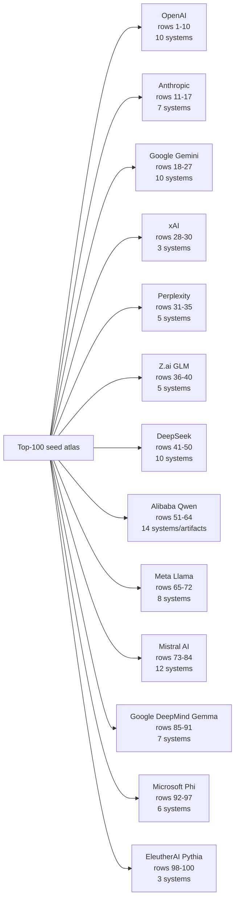
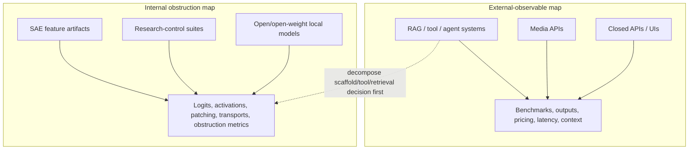
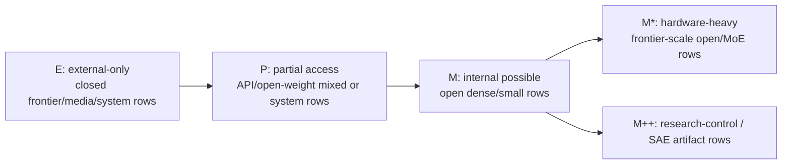
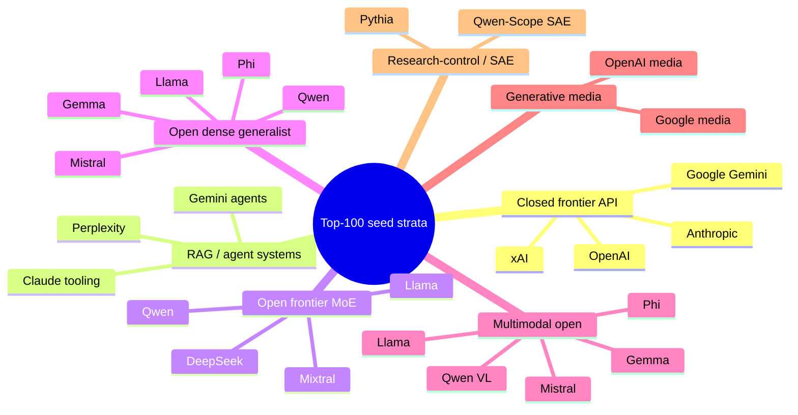

# Top 100 Model Maps V0

Status: seed maps from `docs/notes/public_model_family_atlas_seed_2026_07_02.md`. These are not final leaderboard claims, and all model metadata remains `TODO_VERIFY` unless separately source-verified.

## 1. Provider / Family Map

## 2. External vs Internal Map

## 3. Mechanistic Feasibility Strata

## 4. Architecture / System Strata

